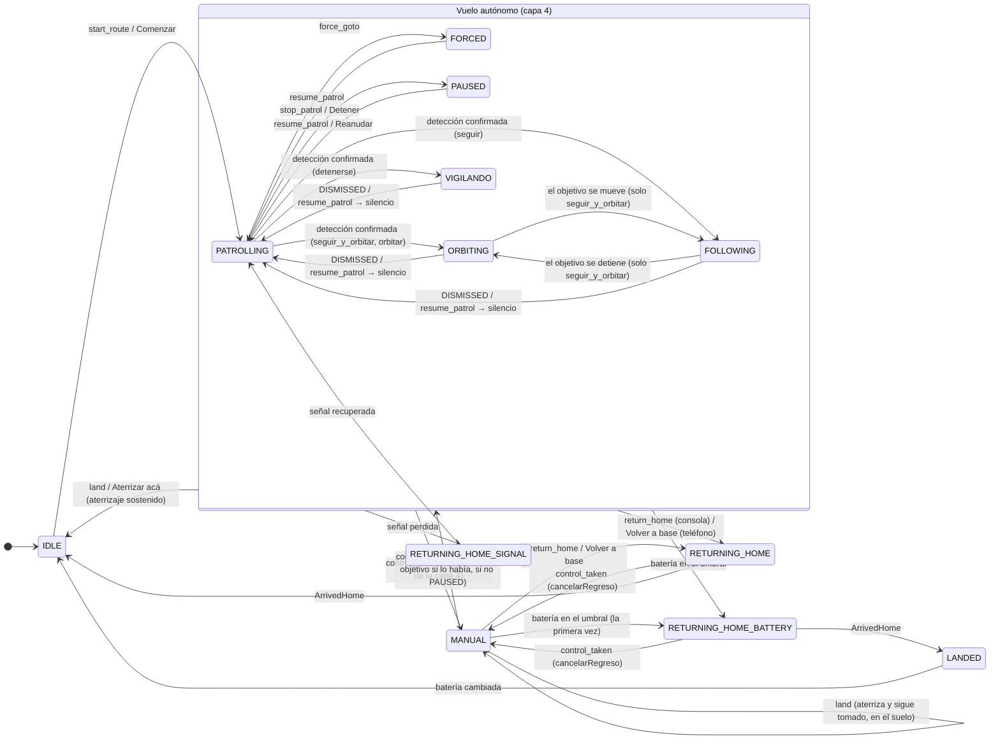
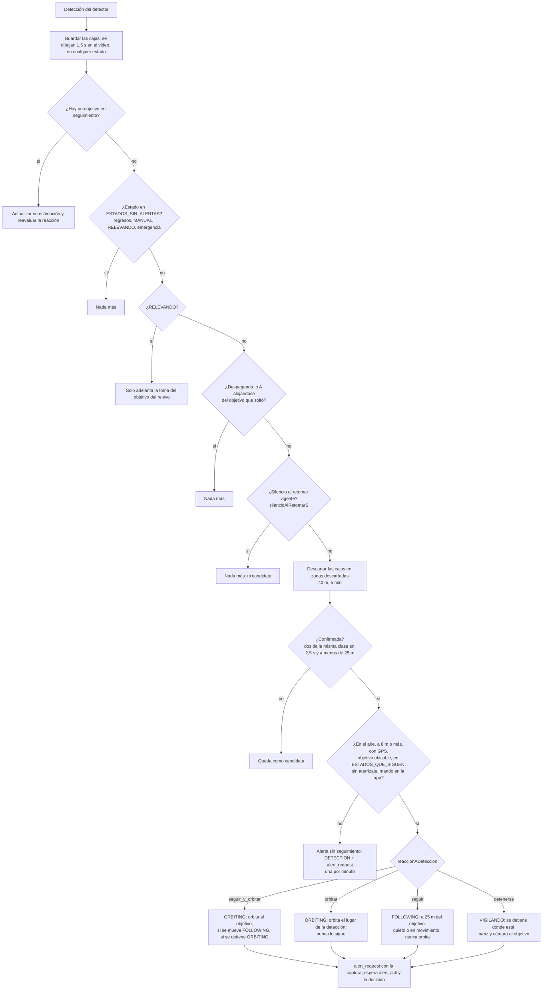
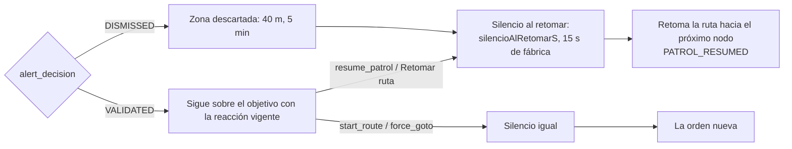
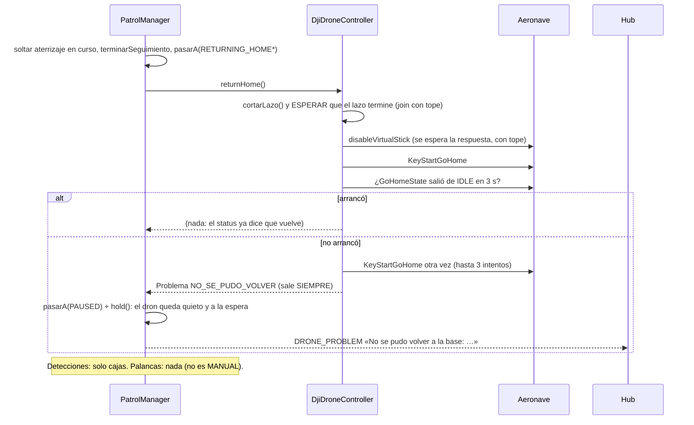
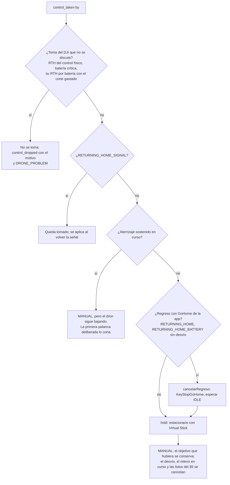

# Vuelo: prioridades, estados y flujos

Qué manda sobre qué cuando el dron vuela solo, cuando lo vuela una persona y
cuando hay que traerlo. Es el diseño detrás de `PatrolManager` (la máquina de
estados de la app), de los controladores (`SimulatedDroneController`,
`DjiDroneController`) y de las órdenes del Comando Central y la consola. Los
mensajes exactos están en `docs/PROTOCOLS.md`; los relevos y las emergencias,
en `docs/RELEVOS.md`. Este documento fija las **reglas de prioridad** y los
**flujos**, y es la referencia de las pruebas de `PatrolManager*Test`.

## 0. Lo que pasó en el campo

Patrullando sobre una playa de estacionamiento, el dron detectó un auto y se
puso a orbitarlo. Desde la consola, «Descartar» lo devolvió a la ruta, y a los
dos segundos detectó el auto de al lado y volvió a orbitar; y así con cada
auto. Se le ordenó volver a la base desde el teléfono: el estado decía que
volvía, pero el dron seguía queriendo orbitar. Se tomó el control manual
desde la consola: la vista de pilotaje se abrió, las palancas no hacían nada.
Lo único que lo trajo fue el control físico RC-N3.

Tres cosas fallaron, y las tres son de prioridades:

1. **Las detecciones mandaban sobre la ruta sin descanso.** Cada «seguir
   patrullando» duraba lo que tardaba en aparecer el siguiente auto.
2. **El regreso a base no se imponía.** La app dejaba de alertar, pero el
   lazo de la órbita (Virtual Stick) seguía vivo mientras el GoHome del DJI
   intentaba arrancar, y uno de los dos ganaba por turnos.
3. **El control manual no se imponía al regreso.** Con el GoHome puesto el
   DJI rechaza el Virtual Stick: la app decía `MANUAL` y el dron seguía con lo
   suyo.

## 1. Las cinco prioridades

De la que más manda a la que menos. Una capa nunca puede frenar, desviar ni
retomar lo que ordenó una capa de arriba; sí puede informar.

| # | Quién manda | Qué es | Qué le puede hacer una capa de abajo |
|---|---|---|---|
| 1 | **El propio DJI** | Sus failsafes que la app no discute (RELEVOS §4): el regreso pedido desde el botón del control físico, el aterrizaje por batería crítica, y su regreso por batería cuando el único corte del vuelo ya se gastó | Nada. La app lo acompaña y avisa (`control_dropped`, `DRONE_PROBLEM`) |
| 2 | **La persona al mando** | El control manual desde la consola (`MANUAL`), y las palancas del RC-N3 cuando la app le devolvió el mando | Nada. Tomar el control corta cualquier cosa de las capas 3 y 4 que esté en curso |
| 3 | **Las órdenes de llegada** | Volver a la base (teléfono, consola, batería, señal, fin de un relevo) y aterrizar (teléfono, consola, §5) | Solo otra orden de una persona: tomar el control, o una orden de vuelo explícita |
| 4 | **El vuelo autónomo** | La ruta, un desvío a un nodo, la órbita o el seguimiento de un objetivo, un relevo | Una detección puede sacarlo de la ruta hacia el objetivo (capa 5), nunca al revés |
| 5 | **Las detecciones** | Lo que ve el detector | Nada: son información. Mueven al dron solo desde la ruta, la pausa o un desvío, y nunca mientras dure un silencio |

Dos corolarios que antes no se cumplían:

- **Volviendo a base o aterrizando, una detección no hace nada**: ni órbita,
  ni seguimiento, ni alerta. Las cajas se siguen dibujando en el video.
- **Tomar el control manual siempre deja al dron en manos de la persona**, lo
  que estuviera haciendo (ruta, órbita, regreso, desvío, relevo, emergencia
  en sus fotos). Las únicas excepciones son las de la capa 1 y el aterrizaje
  de emergencia del §5 ya en su descenso final, y en todas la consola se
  entera de por qué.

## 2. Estados

| Estado | Qué hace el dron | Capa | Detecciones |
|---|---|---|---|
| `IDLE` | En el suelo, listo | — | Alerta sin seguimiento (una por minuto) |
| `LANDED` | En el suelo con la batería por cambiar | — | Alerta sin seguimiento |
| `PATROLLING` | Vuela la ruta | 4 | Confirmada → reacción configurada |
| `FORCED` | Va a un nodo y queda ahí | 4 | Confirmada → reacción configurada |
| `PAUSED` | Vuelo estacionario (patrulla interrumpida) | 4 | Confirmada → reacción configurada |
| `ORBITING` | Orbita al objetivo | 4 | Actualizan la estimación del objetivo |
| `FOLLOWING` | Sigue al objetivo que se mueve | 4 | Actualizan la estimación |
| **`VIGILANDO`** | **Nuevo.** Se detuvo donde estaba al detectar y vigila al objetivo con la nariz y la cámara, sin moverse | 4 | Actualizan la estimación |
| `RELEVANDO` | B yendo a tomar el objetivo de A (RELEVOS §3) | 4 | Solo adelantan la toma de ese objetivo |
| `MANUAL` | Lo vuela una persona desde la consola | 2 | Solo cajas en el video |
| `RETURNING_HOME` | Vuelve a la base por orden de una persona (teléfono o consola) o al terminar un relevo | 3 | Solo cajas |
| `RETURNING_HOME_BATTERY` | Vuelve por batería (también el desvío a otra base) | 3 | Solo cajas |
| `RETURNING_HOME_SIGNAL` | El DJI vuelve solo por pérdida de señal | 1/3 | Solo cajas |
| `ATERRIZAJE_EMERGENCIA` | Protocolo de última ubicación (RELEVOS §5) | 3 | Solo cajas |

Los conjuntos de `PatrolManager` que los agrupan:

- `ESTADOS_QUE_SIGUEN` = `{PATROLLING, PAUSED, FORCED}`: desde dónde una
  detección confirmada arranca la reacción.
- `ESTADOS_DE_SEGUIMIENTO` = `{ORBITING, FOLLOWING, VIGILANDO}`: el dron está
  ocupándose de un objetivo.
- `ESTADOS_SIN_ALERTAS` = los regresos, `RELEVANDO`, `ATERRIZAJE_EMERGENCIA` y
  `MANUAL`.
- `ESTADOS_DE_REGRESO` = los tres regresos y `ATERRIZAJE_EMERGENCIA`: ahí los
  failsafes de la app no vuelven a disparar.

## 3. Diagrama de estados

Las transiciones principales. Los relevos (`RELEVANDO`) y el §5
(`ATERRIZAJE_EMERGENCIA`) están en RELEVOS.md.

## 4. Qué corta qué

Cada fila es algo que puede estar en curso; cada columna, algo que llega.
«Corta» quiere decir que lo que llega se impone y lo que estaba se termina
(con su evento); «no» quiere decir que lo que llega se ignora o se posterga, y
el registro dice por qué.

| En curso ↓ / Llega → | Detección confirmada | `return_home` / Volver a base | `land` / Aterrizar | `control_taken` | Orden de vuelo (`start_route`, `resume`, `force_goto`, `stop`) |
|---|---|---|---|---|---|
| Ruta, pausa, desvío | reacción configurada | corta | corta | corta | corta |
| Órbita / seguimiento / vigilancia | actualiza el objetivo | corta (`TRACKING_ENDED`) | corta | corta (el objetivo se conserva para volver a él al soltar) | corta |
| Silencio tras retomar | **no** (solo cajas) | — | — | — | — |
| Regreso por orden o batería | **no** | ya vuelve | corta el regreso y aterriza donde está | corta (`cancelarRegreso`) | corta |
| Regreso por señal | **no** | **no** (sin enlace) | **no** | se posterga hasta que vuelva la señal | **no** |
| Aterrizaje sostenido | **no** (alerta sin seguimiento) | corta | ya aterriza | **toma el control y el dron sigue bajando**; la primera palanca deliberada corta el aterrizaje | corta |
| Control manual | **no** (cajas) | corta (y el hub suelta el lock) | aterriza y sigue tomado | — | se cumple sin soltar el control |
| Failsafe del DJI (capa 1) | **no** | **no** | **no** | **no** (`control_dropped` con el motivo) | **no** |
| Emergencia §5 en las fotos | **no** | corta | corta | corta (las fotos se cancelan) | corta |
| Emergencia §5 bajando | **no** | **no** | ya aterriza | **no** (se avisa) | **no** |

## 5. Una detección

**La reacción** (`reaccionADeteccion`, un ajuste del dron, §10) decide qué hace
el dron con un objetivo confirmado y mientras lo tenga:

| Reacción | Al confirmar | Si el objetivo se mueve | Si se detiene | Si se pierde (10 s sin verlo) |
|---|---|---|---|---|
| `seguir_y_orbitar` (de fábrica, lo de hoy) | `ORBITING` a 30 m del objetivo; el centro acompaña la estimación si se corre más de 6 m | `FOLLOWING` a 25 m, copiando su velocidad (`TARGET_MOVING`) | vuelve a `ORBITING` (`TARGET_STOPPED`) | orbita la última posición (`TARGET_LOST`) |
| `orbitar` | `ORBITING` con el centro **fijo** en donde se lo detectó | sigue orbitando el lugar (`TARGET_MOVING` igual se avisa) | — | sigue orbitando el lugar (`TARGET_LOST`) |
| `seguir` | `FOLLOWING`: se pone a 25 m, del lado en que está, y se queda ahí | lo sigue | se queda a 25 m, quieto | se queda donde la última estimación (`TARGET_LOST`) |
| `detenerse` | `VIGILANDO`: estacionario donde estaba, girando la nariz al objetivo y bajando la cámara a él (`DroneController.vigilar`) | sigue girando la nariz y la cámara hacia la estimación, sin moverse (`TARGET_MOVING`) | — | queda mirando la última estimación (`TARGET_LOST`) |

Los eventos `TARGET_*` salen en todas las reacciones: la consola los usa para
contar la historia de la alerta y para mandar gente. Cambiar el ajuste con un
objetivo en curso se aplica en la evaluación siguiente (medio segundo). Al
soltar el control manual con un objetivo, el dron vuelve a él con la reacción
vigente. B, al tomar el objetivo de un relevo (RELEVOS §3.5), también usa la
suya.

## 6. La decisión y la retoma: el silencio

**El silencio al retomar** (`silencioAlRetomarS`, un ajuste del dron, de 0 a
30 s de a 5, 15 s de fábrica) empieza cada vez que el dron **deja un objetivo
para volver a volar solo**: un `DISMISSED`, un `resume_patrol` (la consola, el
teléfono, «Soltar y reanudar»), un `start_route` o un `force_goto` dados con
un objetivo en curso. Mientras dura, las detecciones solo dibujan sus cajas:
no cuentan ni como candidata. Antes era fijo en 10 s y solo para el descarte,
y en una playa de estacionamiento el dron no llegaba a pasar de largo el
segundo auto. Con 0 s no hay silencio (las zonas descartadas siguen valiendo).
No empieza con un regreso ni un aterrizaje: ahí no se alerta de todos modos.

La consola lo muestra en el ajuste del dron y en un engranaje al lado de
«Descartar», y el texto de las consecuencias lo dice: «Descartar: retoma la
ruta hacia el próximo nodo y no se detiene por otra detección durante N s».

## 7. Volver a la base

### 7.1 De dónde sale un regreso

| Origen | Estado | Quién lo puede dar | Qué corta |
|---|---|---|---|
| «Volver a base» del teléfono | `RETURNING_HOME` | El operador de campo | Todo lo de la capa 4; suelta el control de la consola (`control_dropped`); aborta un relevo (`ordenDeCampo`) |
| **`return_home` de la consola (nuevo)** | `RETURNING_HOME` | Operador o más con `canControl`; si otro tiene el control manual, solo un supervisor con `forzar` | Todo lo de la capa 4; el hub suelta el lock del que ordenó (no manda `control_released`: la app lo suelta sola con la orden); cancela el relevo como cualquier orden del operador |
| Batería en el umbral | `RETURNING_HOME_BATTERY` | La app (`checkLowBattery`) | Todo lo de la capa 4 salvo en `MANUAL` después de la primera vez; pide relevo; puede desviar a otra base (RELEVOS §4) |
| Fin de un relevo / sin ruta propia | `RETURNING_HOME` | La app | — |
| Señal perdida | `RETURNING_HOME_SIGNAL` | El DJI | Todo: la app no tiene enlace |
| El propio DJI (botón del control, batería) | según `MotivoDelDron` | El DJI | Capa 1: la app lo acompaña |

### 7.2 Qué hace la app con un regreso

Lo nuevo respecto de hoy está en el controlador: **esperar** que el lazo
anterior termine y que el Virtual Stick quede apagado antes del GoHome (como
ya hace el aterrizaje desde el PR #30), **comprobar** que el GoHome arrancó y
**avisar siempre** si no. Antes, una vuelta del lazo de la órbita que estaba
adentro de `enviarVelocidadCuerpo` cuando se apagó el Virtual Stick lo volvía
a habilitar, y el GoHome quedaba pisado sin que nadie se enterara.

### 7.3 Durante el regreso

- Las detecciones no hacen nada (`ESTADOS_SIN_ALERTAS`). Las cajas se dibujan.
- Las palancas y el pad no hacen nada: el estado no es `MANUAL`.
- Lo cortan: `control_taken` (`cancelarRegreso` → `KeyStopGoHome` → `MANUAL`),
  `land`, y las órdenes de vuelo de una persona.
- La batería lo revisa: si no llega a su base, desvía (RELEVOS §4).

## 8. Tomar el control manual

Reglas que lo acompañan:

- **La persona manda** (RELEVOS §3.9): tomar el control no cancela un relevo
  (B lo retoma al soltar), pero sí le saca el vuelo a todo lo demás.
- En `MANUAL` el regreso por batería no vuelve a sacarle el dron a la persona
  después de la primera vez (`regresoPorBateriaOrdenado`), y al soltar vuelve
  a mandar.
- **Si no se toma, se dice por qué**, en el acto: el hub suelta el lock
  (`control_dropped`), la consola cierra la vista de pilotaje y muestra el
  motivo. Nunca más una vista de pilotaje de un dron que no obedece.
- **Durante un aterrizaje sostenido**, el control queda tomado y el dron sigue
  bajando: las palancas en cero (las que manda la consola al soltar, el
  watchdog) no lo tocan. **Una palanca deliberada** —cualquier eje fuera de la
  zona muerta, o un salto del pad— que llegue **1,5 s o más después** de la
  orden de aterrizar corta el aterrizaje (`cancelarAterrizaje`), deja el dron
  estacionario a su mando y registra `LANDING_CANCELLED`. La consola, al
  apretar «Aterrizar» en la vista de pilotaje, suelta las teclas y manda un
  cero antes, así una palanca sostenida de antes no cuenta como deliberada.

## 9. Aterrizar

El aterrizaje sostenido del PR #30 queda igual (`DroneController.land`): se
espera el fin del lazo y el Virtual Stick apagado, `KeyStartAutoLanding` con
tope, confirmación cada 2 s mientras el DJI la pida, reorden si no entra en
modo aterrizaje, `LANDING` recién al aceptarlo y `DRONE_PROBLEM` siempre si no
se puede. Lo nuevo:

- **Desde la consola sin el control** (`land` de la vista del dron): la app lo
  acepta en cualquier estado de vuelo; el hub decide quién puede (§11). Con el
  control tomado por quien ordena, el control sigue tomado en el suelo, como
  hoy.
- **La palanca deliberada lo corta** (§8).

## 10. Ajustes del dron

Tres datos del dron, no de un vuelo: el hub los guarda con el activo, se los
manda a la app en el acto y en cada conexión (`ajustes`), y la ficha los trae.
`null` es «el de fábrica de la app».

| Campo | Valores | De fábrica | Para qué |
|---|---|---|---|
| `velocidadOrbitaMs` | 1–8 m/s (un decimal) | 4 m/s | La velocidad tangencial de la órbita (ya existía) |
| `reaccionADeteccion` | `seguir_y_orbitar` \| `orbitar` \| `seguir` \| `detenerse` | `seguir_y_orbitar` | Qué hace el dron con un objetivo confirmado (§5) |
| `silencioAlRetomarS` | 0, 5, 10, …, 30 | 15 | Cuánto no se detiene por una detección después de dejar un objetivo (§6) |

En la consola viven en la tarjeta «Ajustes del dron» de la vista del dron (la
que hoy se llama «Órbita»): el deslizador de la órbita, un interruptor «Seguir
al objetivo tras una detección» que apagado es `detenerse` y prendido deja
elegir «Seguimiento y órbita», «Órbita en el lugar» o «Seguimiento», y el
deslizador del silencio. El engranaje al lado de «Descartar» en la tarjeta de
la alerta abre el mismo deslizador del silencio para ese dron. Los rangos y los
valores de fábrica están en `docs/contrato/ajustes.json`, que leen las pruebas
del backend, de la consola y de la app.

## 11. Contrato (lo que cambia en PROTOCOLS.md)

**§1 `status.state`**: se agrega `VIGILANDO` (detenido donde estaba, vigilando
al objetivo con la cámara). `RETURNING_HOME` pasa a ser «por orden de una
persona (teléfono o consola) o al terminar un relevo».

**§2 Comando Central → app**:

| Mensaje | Campos | Efecto |
|---|---|---|
| **`return_home`** (nuevo) | `by` | Vuelve a la base como «Volver a base» del teléfono: corta lo de la capa 4, `RETURNING_HOME`, `RTH_MANUAL` «… ordenado por `by` desde el Comando Central». Si la app tenía el control tomado lo suelta sola (sin `control_dropped`: el hub ya soltó el lock al mandar la orden). Ya volviendo, o en el suelo, o en emergencia: solo log. Cancela el relevo como cualquier orden del operador |
| `land` | `by` | Ya no exige el control tomado: aterriza desde cualquier estado de vuelo. Con el control tomado sigue tomado en el suelo. Con un relevo, lo aborta |
| `ajustes` | `velocidadOrbitaMs, reaccionADeteccion, silencioAlRetomarS, by` | Los tres ajustes (§10); cada uno `null` o ausente es el de fábrica. Un valor inválido en cualquiera descarta el mensaje entero |

**§3.b consola → hub**: sin cambios. **§4**: la reacción configurable y el
silencio (este documento §5 y §6).

**§5 REST**:

| Método | Ruta | Auth | Descripción |
|---|---|---|---|
| **POST** | **`/api/drones/:droneId/return_home`** | operador+ con `canControl` | `{forzar?}`. Si otro tiene el control manual: `409` «El control lo tiene X», salvo supervisor+ con `forzar: true`, que se lo quita antes (como «Quitar control», con `resume: 'none'`). Si lo tiene quien ordena, el hub suelta el lock (`CONTROL_RELEASED` «ordenó volver a la base», `control_changed`) sin mandar `control_released` a la app. Manda `return_home`, cancela el relevo (`ordenDelOperador`), registra `RTH_ORDERED`. `404` dron inexistente |
| POST | `/api/drones/:droneId/land` | operador+ con `canControl` | Misma regla del lock que `return_home` (ya no exige ser el titular; si lo es, el lock sigue). Registra `LANDING_ORDERED` |
| PATCH | `/api/drones/:droneId/ajustes` | operador+ | `{velocidadOrbitaMs?, reaccionADeteccion?, silencioAlRetomarS?}`: al menos uno; cada uno `null` vuelve al de fábrica. Nada se convierte. `400` fuera de rango o de tipo. Registra `ORBIT_SPEED_SET`, `DETECTION_REACTION_SET` o `RESUME_SILENCE_SET` por cada campo que cambió, emite `drone_updated` y manda `ajustes` |

**§6 ficha**: `reaccionADeteccion` y `silencioAlRetomarS` junto a
`velocidadOrbitaMs` (`null` = de fábrica).

**§7 eventos**: `RTH_ORDERED {drone, detalle: {por, teniaElControl}}`;
`DETECTION_REACTION_SET {drone, antes: {reaccionADeteccion}, despues: {…}, detalle: {por, reaccionADeteccion}}`;
`RESUME_SILENCE_SET {drone, antes: {silencioAlRetomarS}, despues: {…}, detalle: {por, silencioAlRetomarS}}`;
de la app, `LANDING_CANCELLED` («X movió las palancas: el aterrizaje se corta
y el dron queda a su mando») y el `DRONE_PROBLEM` «No se pudo volver a la
base: …» que sale siempre.

## 12. El caso del estacionamiento, con esto

1. Patrullando, detecta un auto → según la reacción: orbita (de fábrica), lo
   vigila desde donde está, etc. Alerta.
2. «Descartar» → zona descartada, **silencio de 15 s** (o lo que se haya
   fijado), retoma la ruta. Los autos siguientes se dibujan en el video y no
   frenan al dron; a los 15 s, uno nuevo fuera de las zonas descartadas vuelve
   a alertar. Si el operador quiere cruzar la playa entera sin paradas, sube
   el silencio a 30 s desde el engranaje, o apaga «Seguir al objetivo» para
   que el dron solo se detenga y avise.
3. «Volver a la base» (teléfono o consola) → termina el seguimiento, el
   controlador espera que la órbita termine y el Virtual Stick se apague, y
   arranca el GoHome; si no arranca lo reintenta y avisa. Las detecciones no
   hacen nada. El dron vuelve.
4. Si alguien toma el control desde la consola en el medio → `KeyStopGoHome`,
   estacionario, `MANUAL`: las palancas responden. Si el DJI no deja (una
   toma de la capa 1), la consola lo dice en el acto y no abre la vista de
   pilotaje.

## 13. Plan de implementación

Por capa, con lo que prueba cada una. Las cuatro se pueden hacer en paralelo
sobre este documento y `docs/contrato/ajustes.json`; las piezas compartidas
del código (`PatrolState.VIGILANDO`, `ReaccionADeteccion`,
`DroneController.vigilar`, `NO_SE_PUDO_VOLVER`) ya están.

**App (`PatrolManager`, simulador, pruebas)**
- `ReaccionADeteccion` aplicada en `iniciarSeguimiento`, `evaluarSeguimiento`,
  `volverAlObjetivo` y en la toma de B (RELEVOS §3.5); `VIGILANDO` en los
  conjuntos; `vigilar` en el simulador (modo `WATCH`) y el espía.
- `silencioAlRetomarS` en `ajustes`, aplicado en `DISMISSED`, `resumePatrol`,
  `arrancarRuta` y `desviarAlNodo` cuando dejan un objetivo.
- `return_home` del hub (`volverABasePorLaConsola`) y `land` sin el lock.
- La palanca deliberada que corta el aterrizaje (`LANDING_CANCELLED`), con la
  gracia de 1,5 s.
- `NO_SE_PUDO_VOLVER` → `PAUSED` + `hold` + `DRONE_PROBLEM` siempre.
- Pruebas: una por reacción; el silencio con cada orden que lo arranca; las
  detecciones durante cada regreso no dan ni una orden; el regreso desde la
  consola con y sin control; la palanca que corta el aterrizaje (y la que no,
  por llegar antes de 1,5 s o en cero).

**Controlador DJI**
- `returnHome`: join del lazo con tope, `disableVirtualStick` esperado,
  `KeyStartGoHome` con tope, comprobación de `GoHomeState` a los 3 s,
  reintentos, `NO_SE_PUDO_VOLVER` siempre. La decisión en un ayudante puro
  con pruebas (`SupervisorDelRegreso`), como `SupervisorDelAterrizaje`.
- `vigilar`: lazo `VIGILIA` (velocidad cero, nariz al objetivo, altura
  sostenida, gimbal al objetivo), releyendo la estimación.

**Comando Central**
- `ajustes` con los tres campos (columnas `reaccion_deteccion`,
  `silencio_al_retomar_s`), validación estricta, eventos, ficha, mensaje.
- `POST /return_home`, `POST /land` con la regla del lock; `RTH_ORDERED`.
- PROTOCOLS.md §1, §2, §4, §5, §6, §7 y MODELO-DE-DATOS.md.

**Consola**
- «Ajustes del dron» (órbita, reacción, silencio); el engranaje en la alerta.
- «Volver a la base» y «Aterrizar acá» en la vista del dron, con confirmación
  y la regla del lock (y «forzar» para el supervisor).
- `VIGILANDO` en rótulos y tonos; las consecuencias de decidir según la
  reacción y el silencio; el estado «Volviendo a base (por orden)».
- La vista de pilotaje suelta las teclas al apretar «Aterrizar» y avisa que
  una palanca corta el aterrizaje.

**Banco de pruebas con el Mini 4 Pro** (lo que el simulador no puede
confirmar): el GoHome arranca con la órbita recién cortada, y el log
(`adb logcat -s DjiDroneController PatrolManager`) muestra el Virtual Stick
apagado antes; `KeyStopGoHome` al tomar el control durante un regreso; la
vigilancia sostiene la posición con viento; la palanca que corta el aterrizaje
a 1 m.
