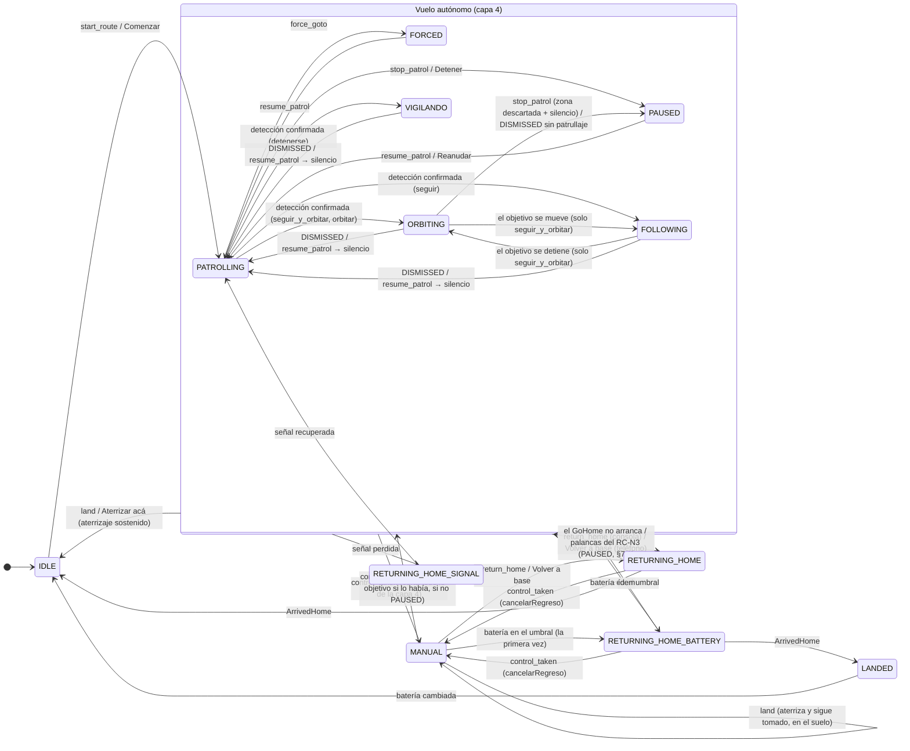
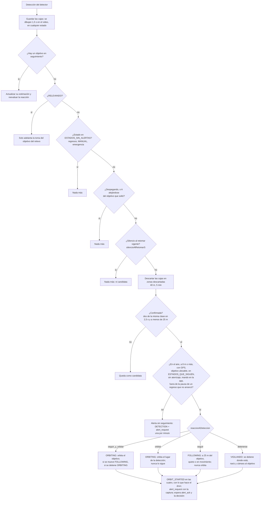
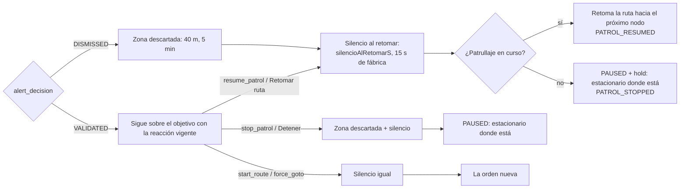
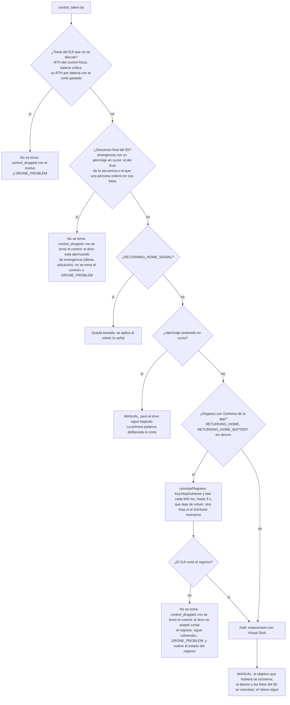

# Vuelo: prioridades, estados y flujos

Qué manda sobre qué cuando el dron vuela solo, cuando lo vuela una persona y
cuando hay que traerlo. Es el diseño detrás de `PatrolManager` (la máquina de
estados de la app), de los controladores (`SimulatedDroneController`,
`DjiDroneController`) y de las órdenes del Comando Central y la consola. Los
mensajes exactos están en `docs/PROTOCOLS.md`; los relevos y las emergencias,
en `docs/RELEVOS.md`. Este documento fija las **reglas de prioridad** y los
**flujos**, y es la referencia de las pruebas de `PatrolManager*Test`.

## 0. Lo que pasó en el campo

Patrullando sobre una playa de estacionamiento, el dron detectó un auto y se
puso a orbitarlo. Desde la consola, «Descartar» lo devolvió a la ruta, y a los
dos segundos detectó el auto de al lado y volvió a orbitar; y así con cada
auto. Se le ordenó volver a la base desde el teléfono: el estado decía que
volvía, pero el dron seguía queriendo orbitar. Se tomó el control manual
desde la consola: la vista de pilotaje se abrió, las palancas no hacían nada.
Lo único que lo trajo fue el control físico RC-N3.

Tres cosas fallaron, y las tres son de prioridades:

1. **Las detecciones mandaban sobre la ruta sin descanso.** Cada «seguir
   patrullando» duraba lo que tardaba en aparecer el siguiente auto.
2. **El regreso a base no se imponía.** La app dejaba de alertar, pero el
   lazo de la órbita (Virtual Stick) seguía vivo mientras el GoHome del DJI
   intentaba arrancar, y uno de los dos ganaba por turnos.
3. **El control manual no se imponía al regreso.** Con el GoHome puesto el
   DJI rechaza el Virtual Stick: la app decía `MANUAL` y el dron seguía con lo
   suyo.

## 1. Las cinco prioridades

De la que más manda a la que menos. Una capa nunca puede frenar, desviar ni
retomar lo que ordenó una capa de arriba; sí puede informar.

| # | Quién manda | Qué es | Qué le puede hacer una capa de abajo |
|---|---|---|---|
| 1 | **El propio DJI** | Sus failsafes que la app no discute (RELEVOS §4): el regreso pedido desde el botón del control físico, el aterrizaje por batería crítica, y su regreso por batería cuando el único corte del vuelo ya se gastó | Nada. La app lo acompaña y avisa (`control_dropped`, `DRONE_PROBLEM`) |
| 2 | **La persona al mando** | El control manual desde la consola (`MANUAL`), y las palancas del RC-N3 cuando la app le devolvió el mando | Nada. Tomar el control corta cualquier cosa de las capas 3 y 4 que esté en curso |
| 3 | **Las órdenes de llegada** | Volver a la base (teléfono, consola, batería, señal, fin de un relevo) y aterrizar (teléfono, consola, §5) | Solo otra orden de una persona: tomar el control, aterrizar, una ruta o un desvío a un nodo (cuál corta cuál, en §4). Reanudar y detener no cortan un regreso |
| 4 | **El vuelo autónomo** | La ruta, un desvío a un nodo, la órbita o el seguimiento de un objetivo, un relevo | Una detección puede sacarlo de la ruta hacia el objetivo (capa 5), nunca al revés |
| 5 | **Las detecciones** | Lo que ve el detector | Nada: son información. Mueven al dron solo desde la ruta, la pausa o un desvío, y nunca mientras dure un silencio |

Dos corolarios que antes no se cumplían:

- **Volviendo a base, una detección no hace nada**: ni órbita, ni
  seguimiento, ni alerta. Las cajas se siguen dibujando en el video.
  **Aterrizando, no lo mueve**: sin el control tomado alerta sin seguimiento
  (`DETECTION`, una por minuto), y con el control, solo las cajas.
- **Tomar el control manual siempre deja al dron en manos de la persona**, lo
  que estuviera haciendo (ruta, órbita, regreso, desvío, relevo, emergencia
  en sus fotos). Las únicas excepciones son las de la capa 1, el aterrizaje
  de emergencia del §5 ya en su descenso final y un regreso que el DJI no
  acepta cortar, y en todas la consola se entera de por qué (§14).

## 2. Estados

| Estado | Qué hace el dron | Capa | Detecciones |
|---|---|---|---|
| `IDLE` | En el suelo, listo | — | Alerta sin seguimiento (una por minuto) |
| `LANDED` | En el suelo con la batería por cambiar | — | Alerta sin seguimiento |
| `PATROLLING` | Vuela la ruta | 4 | Confirmada → reacción configurada |
| `FORCED` | Va a un nodo y queda ahí | 4 | Confirmada → reacción configurada |
| `PAUSED` | Vuelo estacionario: patrulla interrumpida, descarte sin patrullaje que retomar, regreso que no arrancó o que se cortó con las palancas del control (§7.3) | 4 | Confirmada → reacción configurada; aterrizando, tras un regreso que no arrancó o con el mando en el control físico, alerta sin seguimiento (una por minuto) |
| `ORBITING` | Orbita al objetivo | 4 | Actualizan la estimación del objetivo |
| `FOLLOWING` | Sigue al objetivo que se mueve | 4 | Actualizan la estimación |
| **`VIGILANDO`** | **Nuevo.** Se detuvo donde estaba al detectar y vigila al objetivo con la nariz y la cámara, sin moverse | 4 | Actualizan la estimación |
| `RELEVANDO` | B yendo a tomar el objetivo de A (RELEVOS §3) | 4 | Solo adelantan la toma de ese objetivo |
| `MANUAL` | Lo vuela una persona desde la consola | 2 | Solo cajas en el video |
| `RETURNING_HOME` | Vuelve a la base por orden de una persona (teléfono o consola) o al terminar un relevo | 3 | Solo cajas |
| `RETURNING_HOME_BATTERY` | Vuelve por batería (también el desvío a otra base) | 3 | Solo cajas |
| `RETURNING_HOME_SIGNAL` | El DJI vuelve solo por pérdida de señal | 1/3 | Solo cajas |
| `ATERRIZAJE_EMERGENCIA` | Protocolo de última ubicación (RELEVOS §5) | 3 | Solo cajas |

Los conjuntos de `PatrolManager` que los agrupan:

- `ESTADOS_QUE_SIGUEN` = `{PATROLLING, PAUSED, FORCED}`: desde dónde una
  detección confirmada arranca la reacción.
- `ESTADOS_DE_SEGUIMIENTO` = `{ORBITING, FOLLOWING, VIGILANDO}`: el dron está
  ocupándose de un objetivo.
- `ESTADOS_SIN_ALERTAS` = los regresos, `RELEVANDO`, `ATERRIZAJE_EMERGENCIA` y
  `MANUAL`.
- `ESTADOS_DE_REGRESO` = los tres regresos y `ATERRIZAJE_EMERGENCIA`: ahí los
  failsafes de la app no vuelven a disparar.

## 3. Diagrama de estados

Las transiciones principales. Los relevos (`RELEVANDO`) y el §5
(`ATERRIZAJE_EMERGENCIA`) están en RELEVOS.md.



## 4. Qué corta qué

Cada fila es algo que puede estar en curso; cada columna, algo que llega.
«Corta» quiere decir que lo que llega se impone y lo que estaba se termina
(con su evento); «no» quiere decir que lo que llega se ignora o se posterga, y
el registro dice por qué.

| En curso ↓ / Llega → | Detección confirmada | `return_home` / Volver a base | `land` / Aterrizar | `control_taken` | Orden de vuelo (`start_route`, `resume`, `force_goto`, `stop`) |
|---|---|---|---|---|---|
| Ruta, pausa, desvío | reacción configurada | corta | corta | corta | corta |
| Pausa tras un regreso que no arrancó, o cortado con las palancas del control | **no** (alerta sin seguimiento, una por minuto) | corta | corta | corta | corta |
| Órbita / seguimiento / vigilancia | actualiza el objetivo | corta (`TRACKING_ENDED`) | corta | corta (el objetivo se conserva para volver a él al soltar) | corta, con el silencio (§6); `stop_patrol` deja además la zona descartada |
| Silencio tras retomar | **no** (solo cajas) | — | — | — | — |
| Regreso por orden o batería | **no** (solo cajas) | ya vuelve (solo log) | corta el GoHome y aterriza donde está; si el DJI no lo deja cortar, sigue volviendo (§14) | corta (`cancelarRegreso`); si el DJI no lo deja cortar, no se toma (§14) | `start_route` y `force_goto` cortan; `resume_patrol` y `stop_patrol` se ignoran |
| Regreso por señal | **no** (solo cajas) | `return_home`: ya vuelve (solo log); «Volver a base»: **no** (`DRONE_PROBLEM` «No se cumple la orden…») | **no** (`DRONE_PROBLEM` «No se aterriza…») | queda tomado y se aplica al volver la señal (`CONTROL_RESUMED`) | `start_route`, `force_goto` y `resume_patrol`: **no** (`DRONE_PROBLEM` «No se cumple la orden…») |
| Aterrizaje sostenido | no lo mueve: sin el control, alerta sin seguimiento (`DETECTION`, una por minuto); con el control, solo cajas | corta | ya aterriza | **toma el control y el dron sigue bajando**; la primera palanca deliberada corta el aterrizaje (`LANDING_CANCELLED`) | `start_route`, `resume_patrol` (sin `alSoltar`) y `force_goto` cortan; `stop_patrol`, solo en `MANUAL` |
| Control manual | **no** (cajas) | corta (el hub suelta el lock, también si un supervisor lo fuerza; la app suelta el control sola) | aterriza y sigue tomado | — | se cumple sin soltar el control |
| Failsafe del DJI (capa 1) | **no** | **no** (el DJI tiene el vuelo) | **no** (`DRONE_PROBLEM` «No se aterriza…») | **no** (`control_dropped` con el motivo) | **no** |
| Emergencia §5 en las fotos | **no** (solo cajas) | **no** (solo log: no alcanza ninguna base) | corta las fotos y aterriza ya (desde ahí, la fila de abajo) | corta (las fotos se cancelan) | `start_route` y `force_goto` cortan (las fotos se cancelan) |
| Emergencia §5 bajando (el aterrizaje de la secuencia, o el que una persona ordenó en sus fotos) | **no** (solo cajas) | **no** (`DRONE_PROBLEM` «No se cumple la orden…») | ya aterriza (`DRONE_PROBLEM` «No se aterriza…») | **no** (`control_dropped` «no se tomó el control: el dron está aterrizando de emergencia (última ubicación): no se toma el control») | **no** (`DRONE_PROBLEM` «No se cumple la orden…») |

Los textos completos están en §14. Si una orden de una persona corta las fotos
del §5 y la batería sigue por debajo de su disparo, el §5 se vuelve a armar
después: el dron no se queda en el aire con lo justo para bajar.

## 5. Una detección



**La reacción** (`reaccionADeteccion`, un ajuste del dron, §10) decide qué hace
el dron con un objetivo confirmado y mientras lo tenga:

| Reacción | Al confirmar | Si el objetivo se mueve | Si se detiene | Si se pierde (10 s sin verlo) |
|---|---|---|---|---|
| `seguir_y_orbitar` (de fábrica, lo de hoy) | `ORBITING` a 30 m del objetivo; el centro acompaña la estimación si se corre más de 6 m | `FOLLOWING` a 25 m, copiando su velocidad (`TARGET_MOVING`) | vuelve a `ORBITING` (`TARGET_STOPPED`) | orbita la última posición (`TARGET_LOST`) |
| `orbitar` | `ORBITING` con el centro **fijo** en donde se lo detectó | sigue orbitando el lugar (`TARGET_MOVING` igual se avisa) | — | sigue orbitando el lugar (`TARGET_LOST`) |
| `seguir` | `FOLLOWING`: se pone a 25 m, del lado en que está, y se queda ahí | lo sigue | se queda a 25 m, quieto | se queda donde la última estimación (`TARGET_LOST`) |
| `detenerse` | `VIGILANDO`: estacionario donde estaba, girando la nariz al objetivo y bajando la cámara a él (`DroneController.vigilar`) | sigue girando la nariz y la cámara hacia la estimación, sin moverse (`TARGET_MOVING`) | — | queda mirando la última estimación (`TARGET_LOST`) |

`RELEVANDO` se mira antes que `ESTADOS_SIN_ALERTAS`, que lo incluye: B
yendo a relevar no alerta, pero una detección del objetivo que viene a tomar
le adelanta la toma (RELEVOS §3.4).

El arranque deja `ORBIT_STARTED` en las cuatro reacciones —es el evento que
el contrato nombra como el arranque del seguimiento— y su texto dice qué hace
el dron («se detiene donde está y lo vigila con la cámara», por ejemplo). Los
eventos `TARGET_*` también salen en todas: la consola los usa para contar la
historia de la alerta y para mandar gente. Cambiar el ajuste con un objetivo
en curso se aplica en la evaluación siguiente (medio segundo), también con el
objetivo perdido. Al soltar el control manual con un objetivo, el dron vuelve
a él con la reacción vigente (`ORBITING`, `FOLLOWING` o `VIGILANDO`, evento
`TRACKING_RESUMED`). B, al tomar el objetivo de un relevo (RELEVOS §3.5),
también usa la suya.

## 6. La decisión y la retoma: el silencio



**El silencio al retomar** (`silencioAlRetomarS`, un ajuste del dron, de 0 a
30 s de a 5, 15 s de fábrica) empieza cada vez que el dron **deja un objetivo
para volver a volar solo**: un `DISMISSED`, un `resume_patrol` (la consola, el
teléfono, «Soltar y reanudar»), un `start_route`, un `force_goto` o un
«Detener» (`stop_patrol`) dados con un objetivo en curso. «Detener» además
deja la zona del objetivo como descartada, como el descarte: el dron queda
estacionario ahí mismo, y sin eso el mismo auto lo volvía a frenar apenas
terminaba el silencio. Mientras dura, las detecciones solo dibujan sus cajas:
no cuentan ni como candidata. Antes era fijo en 10 s y solo para el descarte,
y en una playa de estacionamiento el dron no llegaba a pasar de largo el
segundo auto. Con 0 s no hay silencio (las zonas descartadas siguen valiendo).
No empieza con un regreso ni un aterrizaje: ahí no se alerta de todos modos.

Un `DISMISSED` sin un patrullaje en curso que retomar deja el dron en `PAUSED`
con `hold`, estacionario donde está, y registra `PATROL_STOPPED` «La alerta se descartó y
no hay un patrullaje en curso que retomar: el dron queda en vuelo
estacionario». La zona descartada y el silencio valen igual.

Un silencio cambiado desde la consola (`ajustes`) vale desde el próximo
objetivo que el dron deje: el que está corriendo no se acorta.

La consola lo muestra en el ajuste del dron y en un engranaje al lado de
«Descartar», y el texto de las consecuencias lo dice: «Descartar: retoma la
ruta hacia el próximo nodo y no se detiene por otra detección durante N s».

## 7. Volver a la base

### 7.1 De dónde sale un regreso

| Origen | Estado | Quién lo puede dar | Qué corta |
|---|---|---|---|
| «Volver a base» del teléfono | `RETURNING_HOME` | El operador de campo | Todo lo de la capa 4; suelta el control de la consola (`control_dropped`); aborta un relevo (`ordenDeCampo`). Sin señal con la aeronave y en el descenso final del §5 no se cumple (`DRONE_PROBLEM` «No se cumple la orden…», §14) |
| **`return_home` de la consola (nuevo)** | `RETURNING_HOME` | Operador o más con `canControl`; si otro tiene el control manual, solo un supervisor con `forzar` | Todo lo de la capa 4: ruta, desvío a un nodo, pausa, órbita, seguimiento, vigilancia, relevo. Con el control tomado —el de quien ordena, o el que un supervisor le quita a otro— el hub suelta el lock sin mandar `control_released`: la app suelta el control sola con CADA `return_home` que recibe teniéndolo, vuele a casa o no (en el suelo, `MANUAL` pasa al reposo). Cancela el relevo como cualquier orden del operador. Ya volviendo (también el desvío a otra base), en el suelo o en las fotos del §5, solo queda en el log, después de soltar el control; en el descenso final del §5, `DRONE_PROBLEM` «No se cumple la orden (…)» |
| Batería en el umbral | `RETURNING_HOME_BATTERY` | La app (`checkLowBattery`) | Todo lo de la capa 4 salvo en `MANUAL` después de la primera vez; pide relevo; puede desviar a otra base (RELEVOS §4) |
| Fin de un relevo / sin ruta propia | `RETURNING_HOME` | La app | — |
| Señal perdida | `RETURNING_HOME_SIGNAL` | El DJI | Todo: la app no tiene enlace |
| El propio DJI (botón del control, batería) | según `MotivoDelDron` | El DJI | Capa 1: la app lo acompaña |

### 7.2 Qué hace la app con un regreso

```mermaid
sequenceDiagram
    participant PM as PatrolManager
    participant DC as DjiDroneController
    participant DJI as Aeronave
    PM->>PM: soltar aterrizaje en curso, terminarSeguimiento, pasarA(RETURNING_HOME*)
    PM->>DC: returnHome()
    DC->>DC: cortarLazo() y ESPERAR que el lazo termine (join con tope)
    DC->>DJI: disableVirtualStick (se espera la respuesta, con tope)
    DC->>DJI: KeyStartGoHome
    DC->>DJI: ¿Arrancó en 3 s? GoHomeState fuera de IDLE, o KeyFlightMode en GO_HOME
    alt arrancó
        DC-->>PM: (nada: el status ya dice que vuelve)
    else no arrancó
        DC->>DJI: KeyStartGoHome otra vez (hasta 3 órdenes en total)
        DC-->>PM: Problema NO_SE_PUDO_VOLVER
        PM->>PM: pasarA(PAUSED) + hold(); con el control tomado, MANUAL + hold()
        PM-->>Hub: DRONE_PROBLEM «No se pudo volver a la base: …» (siempre)
    end
    Note over PM: Detecciones: solo cajas. Palancas de la consola y pad: nada (no es MANUAL).
```

Lo nuevo respecto de hoy está en el controlador: **esperar** que el lazo
anterior termine y que el Virtual Stick quede apagado antes del GoHome (como
ya hace el aterrizaje desde el PR #30), **comprobar** que el GoHome arrancó y
**avisar siempre** si no. Antes, una vuelta del lazo de la órbita que estaba
adentro de `enviarVelocidadCuerpo` cuando se apagó el Virtual Stick lo volvía
a habilitar, y el GoHome quedaba pisado sin que nadie se enterara.

Cuando el GoHome no arranca después de las tres órdenes, el dron queda
estacionario a la espera (`PAUSED` + `hold`; con el control tomado, `MANUAL` +
`hold`) y la consola lo lee siempre en el `DRONE_PROBLEM` «No se pudo volver a
la base: …». En esa pausa una detección confirmada alerta sin seguimiento
(`DETECTION`, una por minuto) hasta que una persona le dé una orden: el dron
no sale a perseguir nada con un regreso pendiente. Si la batería está en el
umbral, la telemetría siguiente lo vuelve a mandar a casa. El «No se pudo
volver» nunca sale sin enlace con la aeronave ni con el dron bajando: ahí no
hay GoHome que comprobar: sin enlace, las órdenes de volver (y de aterrizar)
no cuentan, y el controlador espera el enlace en vez de dar el regreso por
fallido. Un GoHome de la app que se termina en el aire —en vuelo, con enlace,
a más de 2 m y sin estar aterrizando— se detecta y se suelta en el acto, según
el código de salida del DJI: una salida por las palancas (`…OYSTICK_…`) es la
persona al lado del dron (`REGRESO_CORTADO_EN_EL_CONTROL`, §7.3); cualquier
otra avisa «No se pudo volver a la base: el regreso se interrumpió en el aire
(salida=…)» y termina en la misma pausa.

**Seguir volviendo** es, para el controlador, una sola regla: `GoHomeState`
en `RETURNING_TO_HOME`, o en `LANDING` a menos de 30 m de casa, o
`KeyFlightMode` en `GO_HOME`. Cortar el regreso (`cancelarRegreso`, para
tomar el control, aterrizar o desviarse) es `KeyStopGoHome` y leer
activamente, cada 500 ms y hasta 3 s, que el dron deje de volver, con un
segundo Stop si el GoHome vuelve a arrancar; si sigue volviendo, es
`NO_SE_CORTO_EL_REGRESO`.

### 7.3 Durante el regreso

- Las detecciones no hacen nada (`ESTADOS_SIN_ALERTAS`). Las cajas se dibujan.
- Las palancas de la consola y el pad no hacen nada: el estado no es `MANUAL`.
- Lo cortan `control_taken` (`cancelarRegreso` → `KeyStopGoHome` → `MANUAL`),
  `land` (corta el GoHome y aterriza donde está), `start_route` y
  `force_goto` (el controlador manda `KeyStopGoHome` antes de arrancar el lazo
  nuevo). `resume_patrol` y `stop_patrol` se ignoran: son órdenes sobre
  la patrulla, que el regreso ya dejó; una ruta o un nodo, en cambio, son un
  destino que eligió una persona. Un `return_home` repetido solo queda en el
  log.
- Si el DJI no acepta cortar el regreso (`NO_SE_CORTO_EL_REGRESO`), la toma
  se rechaza —`control_dropped` «no se tomó el control: el dron no aceptó
  cortar el regreso: sigue volviendo» y `DRONE_PROBLEM` «No se toma el control
  manual que pidió X: …»— o el aterrizaje se olvida; la app vuelve al estado
  del regreso y el `DRONE_PROBLEM` sale siempre.
- **Las palancas del RC-N3 sí lo cortan**: si la persona al lado del dron las
  mueve, el DJI deja el GoHome. No es una falla: la app no le da ninguna
  orden, pasa a `PAUSED` con el mando en el control físico, suelta el control
  de la consola si alguien lo tenía (`control_dropped` «alguien tomó el dron
  con las palancas del control físico») y registra `RTH_INTERRUPTED` «El
  regreso a base se cortó con las palancas del control físico: el dron queda
  en manos de quien lo vuela al lado». Un estacionario ahí le sacaría el dron
  de las manos.
- La batería lo revisa: si no llega a su base, desvía (RELEVOS §4).

## 8. Tomar el control manual



Reglas que lo acompañan:

- **La persona manda** (RELEVOS §3.9): tomar el control no cancela un relevo
  (B lo retoma al soltar), pero sí le saca el vuelo a todo lo demás.
- En `MANUAL` el regreso por batería no vuelve a sacarle el dron a la persona
  después de la primera vez (`regresoPorBateriaOrdenado`), y al soltar vuelve
  a mandar.
- **Si no se toma, se dice por qué**, en el acto: el hub suelta el lock
  (`control_dropped`), la consola cierra la vista de pilotaje y muestra el
  motivo. Nunca más una vista de pilotaje de un dron que no obedece.
- **Durante un aterrizaje sostenido**, el control queda tomado y el dron sigue
  bajando: las palancas en cero (las que manda la consola al soltar, el
  watchdog) no lo tocan. **Una palanca deliberada** —cualquier eje fuera de la
  zona muerta, o un salto del pad— que llegue **1,5 s o más después** de la
  orden de aterrizar corta el aterrizaje (`cancelarAterrizaje`), deja el dron
  estacionario a su mando y registra `LANDING_CANCELLED`. La consola, al
  apretar «Aterrizar» en la vista de pilotaje, suelta las teclas y manda un
  cero antes, así una palanca sostenida de antes no cuenta como deliberada.

## 9. Aterrizar

El aterrizaje sostenido del PR #30 queda igual (`DroneController.land`): se
espera el fin del lazo y el Virtual Stick apagado, `KeyStartAutoLanding` con
tope, confirmación cada 2 s mientras el DJI la pida, reorden si no entra en
modo aterrizaje, `LANDING` recién al aceptarlo y `DRONE_PROBLEM` siempre si no
se puede. Lo nuevo:

- **Desde la consola sin el control** (`land` de la vista del dron): la app lo
  acepta en cualquier estado de vuelo menos tres —un failsafe del DJI que no
  se discute, la señal perdida (`RETURNING_HOME_SIGNAL`) y el descenso final
  del §5—, y en los tres contesta `DRONE_PROBLEM` «No se aterriza (<orden>):
  <motivo>», que sale siempre. El hub decide quién puede (§11). Con el
  control tomado por quien ordena, el control sigue tomado en el suelo, como
  hoy.
- **Durante un regreso de la app**, el `land` corta el GoHome antes de
  aterrizar, como la toma del control. Si el DJI no acepta cortarlo, el
  aterrizaje se olvida, el dron sigue volviendo y sale el `DRONE_PROBLEM`.
- **Durante las fotos del §5**, aterrizar las corta y baja ya; desde ahí es el
  descenso final de la emergencia (`enElDescensoDeEmergencia`: hay una
  emergencia y un aterrizaje en curso), y como en el de la secuencia no se
  toma el control ni se cumple otra orden de vuelo.
- **La palanca deliberada lo corta** (§8): `LANDING_CANCELLED` «<by> movió
  las palancas: el aterrizaje se corta y el dron queda a su mando».
- **Lo cortan** también, fuera del descenso del §5 (que no se discute, §4),
  `start_route`, `resume_patrol` sin `alSoltar`, `force_goto` y volver a base
  (teléfono o `return_home`). `stop_patrol` lo corta solo en `MANUAL`: fuera
  de él, el aterrizaje sigue.

## 10. Ajustes del dron

Tres datos del dron, no de un vuelo: el hub los guarda con el activo, se los
manda a la app en el acto y en cada conexión (`ajustes`), y la ficha los trae.
`null` es «el de fábrica de la app».

| Campo | Valores | De fábrica | Para qué |
|---|---|---|---|
| `velocidadOrbitaMs` | 1–8 m/s (un decimal) | 4 m/s | La velocidad tangencial de la órbita (ya existía) |
| `reaccionADeteccion` | `seguir_y_orbitar` \| `orbitar` \| `seguir` \| `detenerse` | `seguir_y_orbitar` | Qué hace el dron con un objetivo confirmado (§5) |
| `silencioAlRetomarS` | 0, 5, 10, …, 30 | 15 | Cuánto no se detiene por una detección después de dejar un objetivo (§6) |

En la consola viven en la tarjeta «Ajustes del dron» de la vista del dron (la
que hoy se llama «Órbita»): el deslizador de la órbita, un interruptor «Seguir
al objetivo tras una detección» que apagado es `detenerse` y prendido deja
elegir «Seguimiento y órbita», «Órbita en el lugar» o «Seguimiento», y el
deslizador del silencio. El engranaje al lado de «Descartar» en la tarjeta de
la alerta abre el mismo deslizador del silencio para ese dron, y un
«Descartar» que llega antes de que el silencio recién movido se guarde espera
ese guardado: si no, el descarte salía con el silencio viejo. Los rangos y los
valores de fábrica están en `docs/contrato/ajustes.json`, que leen las pruebas
del backend, de la consola y de la app.

La app valida cada campo del mensaje `ajustes` contra ese archivo, **sin
convertir ni recortar nada**: un valor inválido en cualquiera, o un mensaje
sin ninguna de las tres claves, descarta el mensaje entero, y la app sigue
con los que tenía. Una clave ausente es «el de fábrica», como `null`. Un
silencio nuevo vale desde el próximo objetivo que el dron deje (el que está
corriendo no se acorta), y un cambio de reacción se aplica en la evaluación
siguiente, también con el objetivo perdido.

## 11. Contrato (lo que cambia en PROTOCOLS.md)

**§1 `status.state`**: se agrega `VIGILANDO` (detenido donde estaba, vigilando
al objetivo con la cámara). `RETURNING_HOME` pasa a ser «por orden de una
persona (teléfono o consola) o al terminar un relevo».

**§2 Comando Central → app**:

| Mensaje | Campos | Efecto |
|---|---|---|
| **`return_home`** (nuevo) | `by` | Vuelve a la base como «Volver a base» del teléfono: corta lo de la capa 4 (ruta, desvío a un nodo, pausa, órbita, seguimiento, vigilancia, relevo), `RETURNING_HOME`, `RTH_MANUAL` «… ordenado por `by` desde el Comando Central». Con el control tomado lo suelta sola con CADA `return_home`, vuele a casa o no (sin `control_dropped`: el hub ya soltó el lock al mandar la orden; en el suelo, `MANUAL` pasa al reposo). Ya volviendo (también el desvío a otra base), en el suelo o en las fotos del §5: solo log, después de soltar el control; en el descenso final del §5, `DRONE_PROBLEM` «No se cumple la orden (…)». Volviendo, lo cortan `control_taken`, `land`, `start_route` y `force_goto`; `resume_patrol` y `stop_patrol` se ignoran. Si el GoHome no arranca, hasta 3 órdenes y después `DRONE_PROBLEM` «No se pudo volver a la base: …» siempre, con el dron en `PAUSED` + `hold` (con el control tomado, `MANUAL` + `hold`) |
| `land` | `by` | Ya no exige el control tomado: aterriza desde cualquier estado de vuelo, salvo un failsafe del DJI que no se discute, la señal perdida y el descenso final del §5, donde contesta `DRONE_PROBLEM` «No se aterriza (…): …». Durante un regreso de la app corta antes el GoHome. Con el control tomado sigue tomado en el suelo. Con un relevo, lo aborta. Una palanca deliberada 1,5 s o más después lo corta (`LANDING_CANCELLED`); `stop_patrol` lo corta solo en `MANUAL` |
| `ajustes` | `velocidadOrbitaMs, reaccionADeteccion, silencioAlRetomarS, by` | Los tres ajustes (§10); cada uno `null` o ausente es el de fábrica. La app valida cada uno contra `docs/contrato/ajustes.json` sin convertir ni recortar: un valor inválido en cualquiera, o un mensaje sin ninguna de las tres claves, descarta el mensaje entero |

**§3 hub → consola**: `control_changed` de un soltar lleva además `por` (quién
lo soltó) y `forzado`, y `detalle` con el porqué del registro: el piloto al que
otra persona le quitó el control lee «X te quitó el control: ordenó volver a
la base» en vez de que «se soltó desde otra sesión», en la vista de pilotaje
que se cierra o, fuera de ella, en un aviso.

**§3.b consola → hub**: sin cambios. **§4**: la reacción configurable y el
silencio (este documento §5 y §6).

**§5 REST**:

| Método | Ruta | Auth | Descripción |
|---|---|---|---|
| **POST** | **`/api/drones/:droneId/return_home`** | operador+ con `canControl` | `{forzar?}`. Si otro tiene el control manual: `409` «El control lo tiene X», salvo supervisor+ con `forzar: true`, que se lo quita antes (con `resume: 'none'`). Con el control tomado —el de quien ordena o el que se fuerza— el hub suelta el lock (`CONTROL_RELEASED` «X ordenó volver a la base», `control_changed`) sin mandar `control_released` a la app: ella lo suelta sola con la orden, y un `control_released` antes la hacía volver al objetivo justo antes del regreso. Manda `return_home`, cancela el relevo (`ordenDelOperador`), registra `RTH_ORDERED`. `404` dron inexistente |
| POST | `/api/drones/:droneId/land` | operador+ con `canControl` | Misma regla del lock que `return_home` (ya no exige ser el titular; si lo es, el lock sigue). El que un supervisor fuerza se suelta para las consolas antes de la orden, pero a la app el `control_released` le llega DESPUÉS del `land`: soltar con el aterrizaje en curso no lo frena. Cancela el relevo como `return_home`. Registra `LANDING_ORDERED` |
| PATCH | `/api/drones/:droneId/ajustes` | operador+ | `{velocidadOrbitaMs?, reaccionADeteccion?, silencioAlRetomarS?}`: al menos uno; cada uno `null` vuelve al de fábrica. Nada se convierte. `400` fuera de rango o de tipo. Registra `ORBIT_SPEED_SET`, `DETECTION_REACTION_SET` o `RESUME_SILENCE_SET` por cada campo que cambió, emite `drone_updated` y manda `ajustes` |

**§6 ficha**: `reaccionADeteccion` y `silencioAlRetomarS` junto a
`velocidadOrbitaMs` (`null` = de fábrica).

**§7 eventos**: `RTH_ORDERED {drone, detalle: {por, teniaElControl}}`;
`DETECTION_REACTION_SET {drone, antes: {reaccionADeteccion}, despues: {…}, detalle: {por, reaccionADeteccion}}`;
`RESUME_SILENCE_SET {drone, antes: {silencioAlRetomarS}, despues: {…}, detalle: {por, silencioAlRetomarS}}`;
de la app, `LANDING_CANCELLED` («X movió las palancas: el aterrizaje se corta
y el dron queda a su mando»), `RTH_INTERRUPTED` («El regreso a base se cortó
con las palancas del control físico: el dron queda en manos de quien lo vuela
al lado») y los `DRONE_PROBLEM` que salen siempre: «No se pudo volver a la
base: …», «No se aterriza (…): …» y «No se cumple la orden (…): …».

## 12. El caso del estacionamiento, con esto

1. Patrullando, detecta un auto → según la reacción: orbita (de fábrica), lo
   vigila desde donde está, etc. Alerta.
2. «Descartar» → zona descartada, **silencio de 15 s** (o lo que se haya
   fijado), retoma la ruta. Los autos siguientes se dibujan en el video y no
   frenan al dron; a los 15 s, uno nuevo fuera de las zonas descartadas vuelve
   a alertar. Si el operador quiere cruzar la playa entera sin paradas, sube
   el silencio a 30 s desde el engranaje, o apaga «Seguir al objetivo» para
   que el dron solo se detenga y avise.
3. «Volver a la base» (teléfono o consola) → termina el seguimiento, el
   controlador espera que la órbita termine y el Virtual Stick se apague, y
   arranca el GoHome; si no arranca lo reintenta y avisa. Las detecciones no
   hacen nada. El dron vuelve.
4. Si alguien toma el control desde la consola en el medio → `KeyStopGoHome`,
   estacionario, `MANUAL`: las palancas responden. Si el DJI no deja (una
   toma de la capa 1), la consola lo dice en el acto y no abre la vista de
   pilotaje.

## 13. Plan de implementación

Por capa, con lo que prueba cada una. Las cuatro se pueden hacer en paralelo
sobre este documento y `docs/contrato/ajustes.json`; las piezas compartidas
del código (`PatrolState.VIGILANDO`, `ReaccionADeteccion`,
`DroneController.vigilar`, `NO_SE_PUDO_VOLVER`) ya están.

**App (`PatrolManager`, simulador, pruebas)**
- `ReaccionADeteccion` aplicada en `iniciarSeguimiento`, `evaluarSeguimiento`,
  `volverAlObjetivo` y en la toma de B (RELEVOS §3.5); `VIGILANDO` en los
  conjuntos; `vigilar` en el simulador (modo `WATCH`) y el espía.
- `silencioAlRetomarS` en `ajustes`, aplicado en `DISMISSED`, `resumePatrol`,
  `arrancarRuta` y `desviarAlNodo` cuando dejan un objetivo.
- `return_home` del hub (`volverABasePorLaConsola`) y `land` sin el lock.
- La palanca deliberada que corta el aterrizaje (`LANDING_CANCELLED`), con la
  gracia de 1,5 s.
- `NO_SE_PUDO_VOLVER` → `PAUSED` + `hold` + `DRONE_PROBLEM` siempre.
- Pruebas: una por reacción; el silencio con cada orden que lo arranca; las
  detecciones durante cada regreso no dan ni una orden; el regreso desde la
  consola con y sin control; la palanca que corta el aterrizaje (y la que no,
  por llegar antes de 1,5 s o en cero).

**Controlador DJI**
- `returnHome`: join del lazo con tope, `disableVirtualStick` esperado,
  `KeyStartGoHome` con tope, comprobación de `GoHomeState` a los 3 s,
  reintentos, `NO_SE_PUDO_VOLVER` siempre. La decisión en un ayudante puro
  con pruebas (`SupervisorDelRegreso`), como `SupervisorDelAterrizaje`.
- `vigilar`: lazo `VIGILIA` (velocidad cero, nariz al objetivo, altura
  sostenida, gimbal al objetivo), releyendo la estimación.

**Comando Central**
- `ajustes` con los tres campos (columnas `reaccion_deteccion`,
  `silencio_al_retomar_s`), validación estricta, eventos, ficha, mensaje.
- `POST /return_home`, `POST /land` con la regla del lock; `RTH_ORDERED`.
- PROTOCOLS.md §1, §2, §4, §5, §6, §7 y MODELO-DE-DATOS.md.

**Consola**
- «Ajustes del dron» (órbita, reacción, silencio); el engranaje en la alerta.
- «Volver a la base» y «Aterrizar acá» en la vista del dron, con confirmación
  y la regla del lock (y «forzar» para el supervisor).
- `VIGILANDO` en rótulos y tonos; las consecuencias de decidir según la
  reacción y el silencio; el estado «Volviendo a base (por orden)».
- La vista de pilotaje suelta las teclas al apretar «Aterrizar» y avisa que
  una palanca corta el aterrizaje.

**Banco de pruebas con el Mini 4 Pro** (lo que el simulador no puede
confirmar): el GoHome arranca con la órbita recién cortada, y el log
(`adb logcat -s DjiDroneController PatrolManager`) muestra el Virtual Stick
apagado antes; `KeyStopGoHome` al tomar el control durante un regreso; la
vigilancia sostiene la posición con viento; la palanca que corta el aterrizaje
a 1 m.

## 14. Casos borde

Cada camino que no termina como se pidió, con lo que hace el dron y lo que se
lee en la consola. Los `DRONE_PROBLEM` marcados «siempre» salen sin el techo de
repetición de los demás (PROTOCOLS §1): son la respuesta a una orden de una
persona, y en el campo uno así se perdía detrás de los de 10 Hz.

**Volver a la base**

| Caso | Qué hace el dron | Qué se lee |
|---|---|---|
| `return_home` con el control tomado | La app suelta el control sola, vuele a casa o no; en el suelo, `MANUAL` pasa al reposo | `CONTROL_RELEASED` y `control_changed` del hub, sin `control_dropped` |
| `return_home` ya volviendo (también el desvío a otra base), en el suelo o en las fotos del §5 | Nada más, después de soltar el control | Solo el log de la app |
| El GoHome no arranca | Hasta 3 órdenes; después `PAUSED` + `hold` (con el control tomado, `MANUAL` + `hold`). En esa pausa no persigue detecciones (alerta sin seguimiento) hasta que una persona dé una orden; con la batería en el umbral, la telemetría siguiente lo vuelve a mandar a casa | `DRONE_PROBLEM` «No se pudo volver a la base: …», siempre |
| El GoHome de la app se termina en el aire (en vuelo, con enlace, a más de 2 m, sin estar aterrizando) por otra salida que las palancas | Se detecta y se suelta en el acto: la misma pausa | `DRONE_PROBLEM` «No se pudo volver a la base: el regreso se interrumpió en el aire (salida=…)», siempre |
| Sin enlace con la aeronave, o con el dron bajando | Sin enlace, las órdenes de volver o aterrizar no cuentan: el controlador espera el enlace | Nunca un «No se pudo volver»: ahí no hay un GoHome que se pueda dar por fallido |
| `start_route` o `force_goto` durante un regreso de la app | El controlador manda `KeyStopGoHome` antes de arrancar el lazo nuevo | El evento de la orden |
| Las palancas del RC-N3 durante un regreso de la app (salida `…OYSTICK_…`, `REGRESO_CORTADO_EN_EL_CONTROL`) | El DJI deja el GoHome; la app no da ninguna orden: `PAUSED` con el mando en el control físico | `control_dropped` «alguien tomó el dron con las palancas del control físico» si alguien tenía el control; `RTH_INTERRUPTED` «El regreso a base se cortó con las palancas del control físico: el dron queda en manos de quien lo vuela al lado» |
| `control_taken` o `land` y el DJI no acepta cortar el regreso (`NO_SE_CORTO_EL_REGRESO`) | Sigue volviendo: la toma se rechaza, el aterrizaje se olvida, y la app vuelve al estado del regreso | `control_dropped` «no se tomó el control: el dron no aceptó cortar el regreso: sigue volviendo» (la toma) y `DRONE_PROBLEM`, siempre |
| `resume_patrol` o `stop_patrol` volviendo | Sigue volviendo | Solo el log |

**Aterrizar**

| Caso | Qué hace el dron | Qué se lee |
|---|---|---|
| `land` con un failsafe del DJI que no se discute, sin señal (`RETURNING_HOME_SIGNAL`) o en el descenso final del §5 | Sigue con lo suyo | `DRONE_PROBLEM` «No se aterriza (<orden>): <motivo>», siempre |
| `land` durante un regreso de la app | Corta el GoHome y aterriza donde está (si el DJI no lo deja cortar, ver arriba) | `LANDING` al aceptarlo |
| El dron no acepta aterrizar, acepta y no baja, o lo suben con las palancas | Queda suspendido donde está, con el mando devuelto a quien lo tenía | `DRONE_PROBLEM` «No se pudo aterrizar: …», siempre |
| Una palanca deliberada (un eje fuera de la zona muerta, o un salto del pad) 1,5 s o más después de la orden | Corta el aterrizaje y queda estacionario al mando de la persona | `LANDING_CANCELLED` «<by> movió las palancas: el aterrizaje se corta y el dron queda a su mando» |
| Las palancas en cero, el watchdog o una palanca antes de los 1,5 s | Sigue bajando | — |
| `stop_patrol` con un aterrizaje en curso | Lo corta solo en `MANUAL`; fuera de él, sigue bajando | — |
| Detecciones aterrizando | No lo mueven; sin el control tomado, alerta sin seguimiento | `DETECTION`, una por minuto |

En la consola, el aviso «Aterrizaje ordenado…» de la tarjeta y el
«Aterrizando…» de la vista de pilotaje se van con el dron en el suelo o en
cuanto llega, después de la orden, un `LANDING_CANCELLED` o un `DRONE_PROBLEM`
que empieza con «No se pudo aterrizar» o «No se aterriza» de ese dron.

**La emergencia del §5 y la señal perdida**

| Caso | Qué hace el dron | Qué se lee |
|---|---|---|
| Tomar el control, aterrizar, `start_route` o `force_goto` durante las fotos del §5 | Las fotos se cortan y se cumple la orden; si la batería sigue por debajo de su disparo, el §5 se vuelve a armar | El evento de la orden |
| `control_taken` en el descenso final del §5 (también el aterrizaje que una persona ordenó en sus fotos) | Sigue bajando | `control_dropped` «no se tomó el control: el dron está aterrizando de emergencia (última ubicación): no se toma el control» y `DRONE_PROBLEM` «No se toma el control manual que pidió X: …» |
| Cualquier orden de vuelo en el descenso final (`return_home`, «Volver a base», `start_route`, `force_goto`, `stop_patrol`, `resume_patrol`, Comenzar/Detener/Reanudar) | Sigue bajando | `DRONE_PROBLEM` «No se cumple la orden (<qué>): el dron está aterrizando de emergencia en su última ubicación», siempre |
| Sin señal (`RETURNING_HOME_SIGNAL`): «Volver a base», `start_route`, `force_goto`, `resume_patrol` | El DJI sigue volviendo solo | `DRONE_PROBLEM` «No se cumple la orden (<qué>): sin señal con el dron, el DJI vuelve solo», siempre |
| Sin señal: `control_taken` | Queda tomado y se aplica al volver la señal | `CONTROL_RESUMED` |

**Objetivos, decisiones y ajustes**

| Caso | Qué hace el dron | Qué se lee |
|---|---|---|
| «Detener» (`stop_patrol`) con un objetivo | `PAUSED` estacionario; la zona del objetivo queda descartada y empieza el silencio (§6) | `PATROL_STOPPED` |
| `DISMISSED` sin un patrullaje en curso que retomar | `PAUSED` + `hold`, estacionario donde está; zona descartada y silencio igual | `PATROL_STOPPED` «La alerta se descartó y no hay un patrullaje en curso que retomar: el dron queda en vuelo estacionario» |
| Detecciones volviendo a base | Nada: solo las cajas en el video | — |
| `ajustes` con un valor inválido, o sin ninguna de las tres claves | La app descarta el mensaje entero y sigue con lo que tenía; nada se convierte ni se recorta | El log de la app |
| `ajustes` con una clave ausente | Esa vuelve a la de fábrica, como `null` | — |
| Un silencio nuevo con un silencio corriendo | El que corre no se acorta: el nuevo vale desde el próximo objetivo que el dron deje | — |
| Una reacción nueva con un objetivo en curso | Se aplica en la evaluación siguiente, también con el objetivo perdido | — |
| «Descartar» menos de 600 ms después de mover el silencio en el engranaje | La consola guarda el silencio en el acto y recién después decide | El par de botones apagado mientras tanto |

**El control y las órdenes forzadas**

| Caso | Qué pasa | Qué se lee |
|---|---|---|
| Un supervisor fuerza `return_home` con el control de otro | El hub suelta el lock sin `control_released`: a la app le llega solo la orden (con el `control_released` antes, volvía al objetivo de antes un instante) | El que lo tenía: «X te quitó el control: ordenó volver a la base», en la vista de pilotaje que se cierra o, fuera de ella, en un aviso |
| Un supervisor fuerza `land` con el control de otro | Las consolas y el registro ven el lock suelto antes de la orden; a la app le llega el `land` y DESPUÉS el `control_released`, que no frena un aterrizaje en curso | «X te quitó el control: ordenó aterrizar» |
| `land` o `return_home` con un relevo | El hub resuelve el relevo antes de mandar la orden, como con cualquier orden del operador (RELEVOS §3.9): a B se lo cancela (`CANCELADO`, `orden_del_operador`), y para A en un seguimiento cuenta como `relay_abandon` | `RELAY_CANCELLED` (el de B) |
| La pregunta de «Volver a la base» o «Aterrizar acá» abierta mientras el control cambia de manos | Sale como se leyó: sin forzar, el hub contesta `409` «El control lo tiene X» adentro de la pregunta; la que forzaba a alguien con nombre se descarta | — |
